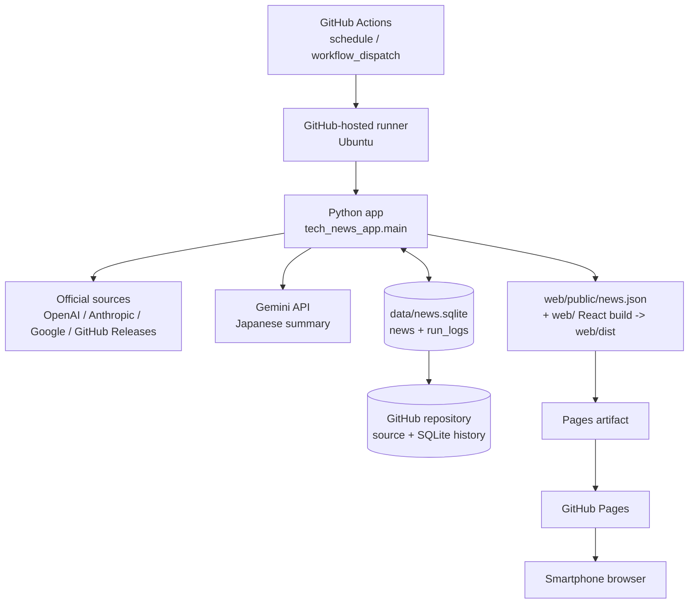
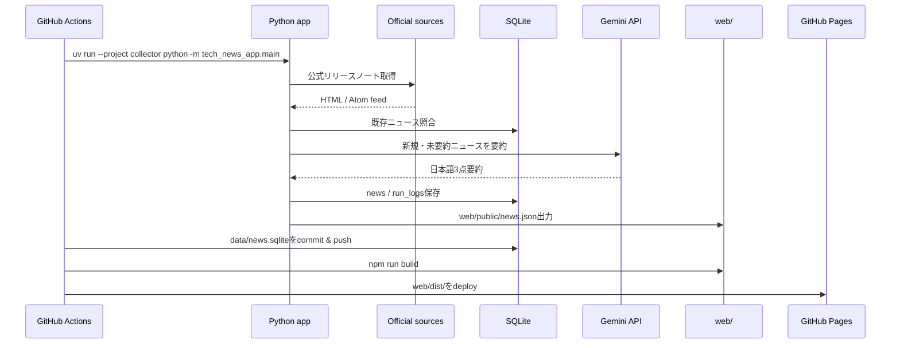

# tech_news_app アーキテクチャ

このドキュメントは、`tech_news_app` がどのサービス・ファイル・処理を使って毎朝のニュースページを生成するかを説明します。

## 全体構成



## 処理フロー

### 1. GitHub Actionsが起動する

`.github/workflows/tech_news_app.yml` が起点です。

起動方法は2つあります。

- 毎日JST 03:07と11:15の定期実行（昼は11:30頃の公開を目指す）
- GitHub Actions画面からの手動実行

GitHub ActionsのcronはUTC基準なので、workflowでは `7 18 * * *`（JST翌日03:07）と `15 2 * * *`（JST11:15）を指定しています。実行の遅延があり、公開時刻は保証されません。03:00ちょうどではなく03:07にしているのは、GitHub Actionsの毎時0分付近の混雑を避けるためです。

### 2. Runner上でPython環境を作る

GitHub-hosted runner上で以下を実行します。

1. リポジトリをcheckout
2. Python 3.12をセットアップ
3. `uv`をセットアップ
4. `uv sync --project collector --locked --all-extras` で依存関係を復元
5. `uv run --project collector pytest collector` でテストを実行

この段階でテストが失敗すると、ニュース取得やPagesデプロイには進みません。

### 3. 公式ソースからニュースを取得する

Pythonアプリは `collector/src/tech_news_app/fetchers.py` と `parser.py` を使って、公式または公式に準ずる一次情報だけを取得します。

対象は以下です。

- OpenAI Help: ChatGPT Release Notes
- Anthropic Support: Claude Release Notes
- Anthropic Docs: Claude Code Changelog
- GitHub Releases: `anthropics/claude-code`
- Anthropic: Claude Cowork Changelog(Claude Desktopのリリースノート)
- Anthropic Support: Claude Cowork ヘルプセンター(記事の更新を検知)
- OpenAI: Codex Changelog
- Google: Gemini Apps Release Notes(英語版)
- Google: Workspace Updates の Gemini App カテゴリ(Atom)

取得元ごとにHTML構造が違うため、パーサーはソース別に分けています。1つのソース取得に失敗しても、他のソースの取得とサイト生成は継続します。

#### ヘルプセンター記事の更新検知

Coworkの方針変更(例: 2026-10-06のPro/Maxのクラウド実行化)は、リリースノートではなくヘルプセンター記事だけに記載されました。そこで `kind="helpcenter"` の取得元は、コレクションページに埋め込まれた記事ごとの最終更新日時(`lastUpdatedDate`)を見て、直近14日以内に更新された記事を取得します。

- 記事の更新1回を1件のニュースとして扱います。`item_url` に更新日時を含める(`...#updated-20261006T191325Z`)ため、同じ更新は重複せず、再編集は新しい記事になります。
- タイトルは `Help Center: <記事名>` です。要約は本文から「最近の変更点」を優先して生成します。
- 変更前後の差分は取らないため、誤字修正などの軽微な更新もニュースになることがあります。

#### ChatGPT Workの区分

ChatGPT Workの更新はChatGPT Release Notesの中で配信されます。DBのproductは `ChatGPT` のまま、`exporter.py` の `display_product()` が、タイトルまたは本文冒頭300文字に製品名としての `Work` を含む記事を `ChatGPT Work` として出力します。

### 4. Gemini APIで日本語要約する

`GEMINI_API_KEY` がGitHub ActionsのRepository Secretに設定されている場合、`collector/src/tech_news_app/summarizer.py` がGemini APIを呼び出して日本語要約を生成します。

使用モデルは環境変数で指定します。

```text
GEMINI_MODEL=gemini-3.5-flash-lite
```

無料枠のレート制限を避けるため、呼び出し間隔は以下で制御します。

```text
GEMINI_MIN_INTERVAL_SECONDS=4.1
```

Gemini APIキーが未設定、API呼び出し失敗、レート制限、その他エラーの場合でもアプリは止まりません。その場合は、英語本文を長く表示せず、以下の定型文にフォールバックします。

```text
要約未生成。公式ページで確認してください。
```

この定型文のまま保存された記事は、次回以降の実行で再要約します。取得範囲に含まれる記事は取得時に、取得範囲外の過去記事は新しい順に1回あたり最大50件まで再要約し、API失敗を検知した時点で打ち切ります。

アプリ独自の日次API回数上限は設けません。呼び出し間隔は既定4.1秒です。429受信後はその実行中の追加呼び出しを止め、未要約分を次回以降へ回します。

既存記事のタイトル・本文のハッシュが変わった場合は再要約し、本文・タイトル・ハッシュ・重要度・要約を一緒に更新します。記事ID、初回取得日時、新着判定は維持します。変更のない記事は既存要約を再利用します。API応答の候補・本文が空または不正な場合は、未要約として保存します。

### 5. SQLiteへニュースと実行ログを保存する

保存先は以下です。

```text
data/news.sqlite
```

SQLiteには以下のデータを保存します。

- `news`: ニュース本文、要約、URL、公開日、重要度、重複判定用hashなど
- `run_logs`: 実行日時、成功/部分成功/失敗、新規件数、エラー概要など

重複判定は次の観点で行います。

- 同じ `item_url`
- 同じ `product + title + published_at`
- 同じ `content_hash`

GitHub-hosted runnerは実行ごとに破棄されるため、SQLiteをrunner内に置くだけでは次回へ引き継げません。そのため、workflowの最後で `data/news.sqlite` をGitHubリポジトリへcommitしてpushします。

### 6. news.jsonを出力し、Webサイトをビルドする

`collector/src/tech_news_app/exporter.py` がDBの全ニュースを `web/public/news.json` へ出力します。news.jsonには記事一覧のほか、生成日時、新着件数、プロダクト一覧、取得エラーを含めます。

画面に表示する日付は、リリースノート記載の日付(ベンダー現地の日付)ではなく、日本(JST)で見える日付です。`exporter.py` の `display_date()` が `date`(と、それに合わせた `month`)として出力します。

- 公開日から3日以内に初めて取得した記事は、初回取得日(JST)を使います。朝・昼どちらの新着も当日のカテゴリに入ります。
- 初回取得が公開日から3日を超えて遅れた記事（初回の過去分取り込みなど）は公開日を使います。時刻付き公開日はJSTに変換します。
- `is_new`と`new_count`は日本時間の当日に初めて取得した記事を対象にし、同日の再実行でも維持します。`run_logs`の新規件数は従来どおり実行ごとの追加件数です。

画面は `web/`(Vite + React + TypeScript)です。`npm run build` で `web/public/news.json` を含む静的ファイルを `web/dist/` へ出力します。

- `src/App.tsx`: news.jsonの読み込み、フィルタ状態、初期表示(Highlights)と「さらに表示」の制御
- `src/components/`: ヘッダー、フィルタバー、ニュースカード
- `src/lib/news.ts`: 絞り込み、初期表示の選定、日付グループ化、3行要約の分解(vitestでテスト)

### 7. GitHub Pagesへデプロイする

workflowは `web/dist/` をPages artifactとしてアップロードし、`actions/deploy-pages` でGitHub Pagesへ配信します。

スマホからはGitHub PagesのURLへアクセスします。

```text
https://meak-c.github.io/tech_news_app-/
```

ブラウザは `index.html` とビルド済みのJS/CSSを読み込み、その後 `news.json` を取得してニュースダッシュボードを表示します。

## 主要コンポーネント

| コンポーネント | 役割 |
|---|---|
| GitHub Actions | 定期実行、テスト、ニュース生成、DB永続化、Pagesデプロイ |
| GitHub-hosted runner | Pythonアプリの実行とWebビルドを行う一時的なUbuntu環境 |
| uv | Python依存関係の解決と実行 |
| Python app (collector/) | 取得、解析、要約、保存、news.json出力 |
| Gemini API | 日本語要約生成 |
| SQLite | ニュース履歴と実行ログの保存 |
| GitHub repository | ソースコードとSQLiteの永続化 |
| GitHub Pages | スマホから閲覧する静的サイト配信 |
| React app (web/) | フィルタ、検索、カード開閉、初期表示制御 |

## データの流れ



## 運用上の注意

- Gemini APIキーはGitHub Secretsの `GEMINI_API_KEY` に保存します。
- APIキーの実値はMarkdown、ソースコード、JSON、SQLite、ログへ書きません。
- Free Tier運用では、Geminiへ送る内容を公開済み公式リリースノートに限定します。
- GitHub Pages artifactだけではSQLiteは永続化されないため、DBをリポジトリへcommitします。
- SQLiteはバイナリファイルなので、長期運用では履歴サイズが増えます。
- 取得元サイトのHTML構造変更で一部パーサーが壊れる可能性があります。その場合も他ソースの取得とサイト生成は継続する設計です。
